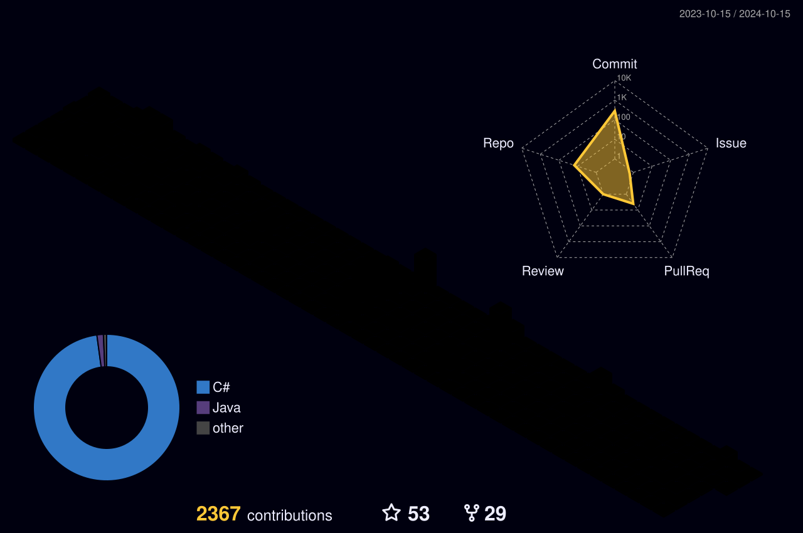

# João Pedro Alves de Moraes

### Senior Backend Software Engineer  
**.NET • Java • Python • AWS • Distributed Systems • Generative AI**

  
  
  

Building scalable backend systems, cloud-native applications and AI-powered solutions.

---

## Live GitHub dashboard

---

## Contribution map

---

## Core stack

  

---

### Backend • Cloud • Distributed Systems • Observability • Generative AI

